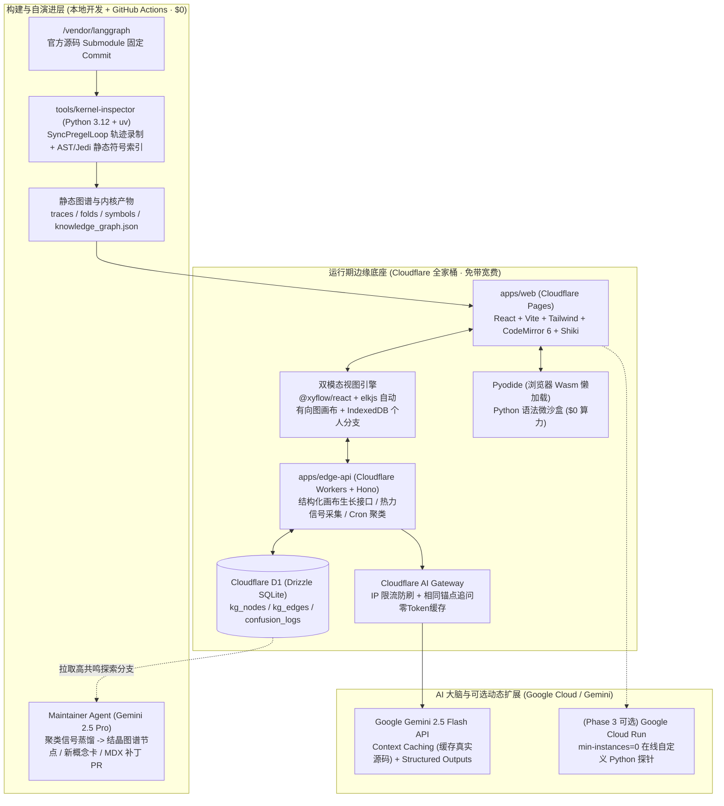

# 产品需求文档（PRD）：LangGraph X-Ray —— 交互式源码解剖与自演进知识图谱系统

| 文档版本 | v1.2（主脊柱锚定 · 语义生长画布定稿版） | 产品形态 | 双模态源码解剖台 $\leftrightarrow$ 受控自动生长语义画布 |
| :--- | :--- | :--- | :--- |
| **核心定位** | 面向彻底吃透 LangGraph 底层引擎的三维无损认知与自演进知识图谱系统 | **开发范式** | Content-as-Code + Graph-as-Data + AI Coding Agent 驱动 |
| **技术底座** | Cloudflare (Pages / Workers / D1 / AI Gateway) + Google Gemini API (Context Caching + Structured Outputs) + Python AST/Jedi 离线构建链 | **目标成本** | 固定基础设施成本趋近 \$0/月，静态免带宽费、按需弹性抗刷 |

---

## 1. 产品背景与核心愿景

### 1.1 背景与五大核心障碍
学习者在深入阅读 LangGraph 源码（`libs/langgraph` 与 `libs/checkpoint`）并借助大模型辅助学习时，普遍面临五大核心障碍：
1. **调用栈与跨文件跳转迷航（Call-Stack & Go-to-Definition Disorientation）**：在 IDE 单步跟进 `SyncPregelLoop` $\rightarrow$ `prepare_next_tasks` $\rightarrow$ `PregelNode` $\rightarrow$ `ChannelWrite` 多层嵌套后极易丢失全局生命周期坐标；同时为查阅 `Checkpoint`、`PregelNode`、`BaseChannel` 等分散在不同目录的静态类型定义而频繁 `Cmd+Click` 切 Tab，3 分钟内就会击穿大脑工作记忆栈（“跳转失忆症”）。
2. **工程噪音淹没主干（Boilerplate Overload）**：生产级源码中约 70% 为同步/异步双模兼容、LangSmith 追踪回调、泛型校验、重试包装等防御性胶水代码，掩盖了核心的 Google Pregel（BSP 整体同步并行）状态机算法。
3. **正交前置知识断层（Orthogonal Prerequisite Gaps）**：读者背景差异显著——跨语言开发者可能对 Python 的 `Annotated`、`ContextVar`、`yield` 生成器短路等机制陌生；应用开发者可能未读过 Google 2010 *Pregel* 经典论文（不清楚同步屏障与 `Vote to Halt` 的由来）。把背景扫盲硬塞入正文会让资深老手嫌啰嗦；甩外部链接又会让新手跳出页面后再也回不到原代码行。
4. **线性聊天坍塌 vs 自由白板失控（Linear Chat Collapse vs. Freeform Canvas Chaos）**：由于大模型的通用性，读者围绕一行源码的追问天然是**不确定、多方向网状生长的**（既可能下钻底层类实现，又可能横跳分布式理论或推演并发异常）。传统的“单列聊天抽屉”会把立体的分支思考压扁成流水账；而照搬 Miro 式的“纯自由无限白板”，又会因为任意缩放毁掉代码等宽可读性、迫使读者沦为手动拖拽对齐卡片的“桌面清洁工”，并因丢失超步时间主轴与无约束发散退化为一团杂乱的“毛线球图谱（Hairball Graph）”。
5. **非确定性调试干扰（Non-Deterministic Noise）**：通过真实 LLM 业务应用学源码会因网络延迟与随机输出破坏断点重放的幂等性；而传统静态博客又缺乏运行时内存快照（如 `channel_versions` 与 `versions_seen`）的直观印证。

### 1.2 产品愿景
打造一个**“零业务噪音、100% 挂载真实内核数据、主干稳如 IDE 解剖台、探索顺如自动生长语义画布、且通过三层漏斗不断结晶进化”**的源码通关系统：
* **对创作者（主编）**：通过构建确定性探针关卡、核验沙盒轨迹与审核 AI 自动提交的图谱结晶 PR，以费曼学习法倒逼自己无死角吃透源码。
* **对读者（学习者）**：在**「聚焦解剖台」**顺着清晰时间轴读源码、看手边静态契约、拨动超步内存沙盒；一旦产生好奇或困惑，无缝推开**「受控生长语义画布」**，以当前代码行为锚点向右多分支发散探索，由系统自动排版并自动连回底层类与论文节点，织成专属的源码认知网络。

---

## 2. 核心设计原则

1. **零造假数据源（Build-Time Real Kernel Driven）**：前端渲染的每一个版本号递增、任务唤醒、静态类契约与局部变量类型推导，均由构建期挂载本地真实 `langgraph` 源码运行确定性 Mock 探针及离线静态分析提取生成，严禁前端硬编码假动画。
2. **主脊柱锚定 + 受控生长语义画布（Spine-Anchored Semantic Canvas）**：
   * **守住定力（主脊柱 Spine）**：6 关主线与 Pregel 超步时序构成不可动摇的“高铁主干线”，保证代码恒定等宽字号与清晰的学习先后顺序，新手绝不迷路。
   * **释放生长力（自动拓扑画布 Auto-Layout DAG）**：告别手动拖拽 `(x, y)` 坐标的自由白板，采用图布局算法（`ELK.js` / `Dagre`）向右自动无重叠排布衍生卡片；**像树一样分叉追问（Tree Growth），像图一样跨节点自动互链（Graph Closure）**。
3. **万物皆类型化图谱节点（Unified Typed Knowledge Graph）**：主线源码块、手边静态类定义、*Pregel* 论文切片、Python 语法微沙盒与 AI 答疑洞见，在底层不再是割裂的功能插件，而是同一张有向属性图中的 **5 类标准节点**，通过语义边自然连接。
4. **三层漏斗治理无序生长（Sprout $\rightarrow$ Cluster $\rightarrow$ Crystallize）**：兼顾个人探索的无限自由与公共教程的极致高信噪比——个人发散存本地 `IndexedDB`（零负担）、共性困惑在 Cloudflare D1 聚类计票、高价值支线由 Maintainer Agent 蒸馏为 $\le 150$ 字的原子图谱节点提 PR 结晶入库。
5. **边缘极简与极致低成本（Edge-First & Near-Zero Fixed Cost）**：将 Python 内核录制与 AST/Jedi 索引前置到构建期（本地 + GitHub Actions），线上依托 Cloudflare 边缘网络与 Google Gemini 上下文缓存 + 结构化输出，实现接近 \$0/月固定成本与天然防刷兜底。

---

## 3. 总体交互形态（三挡无感变速工作台）

系统拒绝“一刀切”的单一布局，提供围绕同一套底层图谱数据的**三挡无感切换视图**：

### 3.1 一挡：聚焦解剖台（Focus Spine Workbench —— 默认主线阅读态）
保持现代 IDE 级的高信息密度与稳定心流，分为顶栏与左中右三主栏：
* **顶栏：双维全局导航 Mini Map + 知识透镜开关 + 视图挡位切换器**
  * 左侧关卡进度，中部横铺 **Pregel 生命周期阶段轴** 与 **实时图拓扑缩略雷达**；
  * 右侧常驻 **「知识透镜（Knowledge Lens）」滤镜组**（`[🐍 Python 语法]`、`[📄 Pregel 论文]`、`[🔗 Runnable 契约]`、`[⚡ 老手纯净模式]`）以及 **`[🔬 解剖台 | 🕸️ 生长画布 | 🗺️ 全局星图]`** 挡位切换开关。
* **左栏（28%）：交互式精读教程区（MDX 主脊柱）**
  * 承载通关讲解、受透镜控制的背景概念虚线锚点、以及标记该段落已沉淀分支数量的 **「🌿 衍生知识脉络微标」**（如 `🌿 3 条支线`）。
* **中栏（40%）：分层源码视窗（L0~L3 缩放器 + 局部变量类型透视）**
  * 顶部配有 `[L0 概念] [L1 骨架] [L2 核心源码] [L3 全量源码]` 切换开关；代码行与沙盒步进双向高亮联动，类名与**核心局部变量（如 `proc`、`chan`、`writes`）**支持零跳转点击透视静态结构，划选任意代码即可在画布中长出新追问分支。
* **右栏（32%）：手边器械盘（At-Hand Tray）+ Pregel 白盒内存沙盒（State X-Ray）**
  * **上部 · 「🧰 手边器械盘」**：常驻钉住本关核心对象静态结构卡（支持「精简契约 / 契约 $\times$ 当前步实时值 / 原始定义」三态切换）；
  * **下部 · 运行时内存对比器**：步进控制器（`Prev` / `Next Phase` / `Next Superstep`）+ `channel_values`、`channel_versions`、`versions_seen`、`TASKS` 队列与 `scratchpad` 实时 Diff。

### 3.2 二挡：受控生长语义画布（Exploration Semantic Canvas —— 多维发散探索态）
当读者点击任意代码/段落旁的 `🌿 展开衍生脉络`，或划词发起多方向追问时，工作台平滑推开进入受控语义画布：
* **左侧锁死「源头锚点舱（Origin Anchor Dock）」**：触发探索的那段真实源码与当前超步快照锁死在画布最左端作为时空原点，确保无论向右衍生几层都绝不迷航。
* **右侧自动拓扑生长区（`@xyflow/react` + `elkjs` 无重叠有向图）**：
  * **零排版税**：所有新生长或展开的节点自动计算分层 DAG 坐标、平滑推开，锁死最佳代码阅读字号（仅平移聚焦与子树折叠，不破坏等宽代码排版）。
  * **实线演化树（Tree Sprouting）**：从源头或任意已生成卡片内部继续追问，向右拉出实线有向边（`evolves_to`），天然支持同一锚点并发探索 3~4 个截然不同的方向。
  * **虚线图谱闭合（Graph Cross-Linking）**：当大模型生成的解答节点提及已有底层类（如 `NamedBarrierValue`）、Python 机制或 *Pregel* 论文概念时，画布自动将该静态契约卡/论文卡召唤至旁侧，并用虚线语义边连接——让碎片问答自动编织成结构化知识图谱。

### 3.3 三挡：全局内核知识星图（Global Kernel Atlas —— 跨关卡俯瞰态）
全屏俯瞰整个 LangGraph 内核的全局知识拓扑：直观呈现 Ch.1~Ch.6 的核心源码模块如何共同围绕 `BaseChannel`、`Checkpoint`、`PregelExecutableTask` 等枢纽节点耦合运转，高亮社区高频困惑热力区与读者个人的探索点亮进度。

---

## 4. 核心功能模块详述

### 4.1 六关通关式课程内容体系（中央主脊柱）
每一关绑定一个独立的最小确定性 Python 探针图（零真实 LLM 依赖，毫秒级确定性重放）：

| 关卡 | 关卡主题 | 探针图特征 | 核心解剖源码路径 |
| :--- | :--- | :--- | :--- |
| **Ch.1** | 编译的魔法：`StateGraph` 如何变成 `Pregel` | 含 `LastValue` 与 `Annotated[list, add]` 状态及条件边 | `graph/state.py`, `channels/last_value.py`, `channels/binop.py` |
| **Ch.2** | Superstep 脉搏与版本号唤醒机制 | 扇出（Fan-out）并行分支 A $\rightarrow$ [B, C] $\rightarrow$ D 汇聚 | `pregel/loop.py`, `pregel/algo.py` (`prepare_next_tasks`, `apply_writes`) |
| **Ch.3** | 打破静态拓扑：`Send` 与 `Command` 暗道 | 动态 Map-Reduce 裂变与 `Command(update=..., goto=...)` | `types.py`, `channels/topic.py` (`TASKS`), `pregel/write.py` |
| **Ch.4** | `interrupt()` 真相：异常冒泡与幂等重放 | 节点中途调用 `interrupt()` 挂起及 `Command(resume=...)` | `errors.py` (`GraphInterrupt`), `pregel/loop.py`, `scratchpad` 机制 |
| **Ch.5** | 时间旅行：Checkpointer 四大件剖析 | 多步快照回溯、修改历史状态引发分叉（Fork）重跑 | `libs/checkpoint/langgraph/checkpoint/base/__init__.py` |
| **Ch.6** | 子图嵌套与流式事件透传 | 父图节点内调用编译子图，开启多模式 `stream_mode` | `pregel/main.py`, `pregel/messages.py`, `checkpoint_ns` 命名空间 |

---

### 4.2 双维全局导航 Mini Map（架构 GPS）
1. **宏观生命周期进度轴**：`[1. Build 声明]` $\rightarrow$ `[2. Compile 编译]` $\rightarrow$ `[3. Superstep Loop: Plan -> Execute -> Apply Writes]` $\rightarrow$ `[4. Checkpoint 落盘]` $\rightarrow$ `[5. Stream / Interrupt]`。
2. **实时图拓扑态势雷达**：以灰（Idle）、蓝闪烁（Planned/Active）、绿（Committed）、红（Interrupted）四色实时映射探针图各节点状态，支持点击反向跳转对应源码与内存帧。

---

### 4.3 纵轴：分层可观测性与复杂度折叠（L0~L3 语义缩放）
* **L0（概念状态视图）**：仅展示用户 `StateGraph` 业务代码与前后 `State` 字典 Diff。
* **L1（核心算法骨架）**：提炼 25~40 行纯 Python 核心循环伪代码，3 分钟抓准算法灵魂。
* **L2（真实核心源码 + 噪音折叠，默认推荐）**：渲染真实源码并保留真实行号，将 `LangSmith 追踪`、`Async/Sync 双模分派`、`RetryPolicy 包装`、`类型校验` 收起为可点击展开的语义胶囊。
* **L3（100% 全量源码 + 内存显微镜）**：全量展开，悬停关键变量直接浮窗显示当前沙盒步真实内存值。

---

### 4.4 Pregel 白盒内存沙盒（右栏状态对比器）
支持精确到半步（Phase 级）的高亮 Diff 观察：**唤醒判定对照矩阵**（全局 `channel_versions` vs 节点 `versions_seen`）、**并行节点读写隔离视图**、以及 **中断草稿箱（Scratchpad & Pending Writes）**。

---

### 4.5 横轴：正交背景知识透镜（Knowledge Lens & 原位展开 / 图谱挂载）
1. **读者画像滤镜降噪（持久化于本地 `localStorage`）**：独立开关控制 `🐍 Python 高阶语法`、`📄 Pregel 论文溯源`、`🔗 Runnable 协议契约`；老手关闭透镜后正文中虚线微标完全隐形。
2. **三级渐进展开（兼容解剖台原位浮窗与生长画布独立节点）**：
   * **Tier 1 · 3 秒语境扫盲**：仅回答“在此处源码中的作用” + “跨语言直觉类比”（如 `ContextVar` 类比 Node.js `AsyncLocalStorage`）。
   * **Tier 2 · 3 分钟深度切片**：
     * **Paper-to-Code 桥接卡**：并列展示 Google *Pregel (SIGMOD 2010)* 原文摘录、中文精译、对应源码行号及 **「LangGraph 工程演进差异」**。
     * **8 行纯 Python 微沙盒**：按需懒加载浏览器端 **Pyodide (WebAssembly)** 零服务器成本运行最小语法实验。
   * **Tier 3 · 画布分支追问**：一键在生长画布中派生携带读者透镜偏好的深度探索节点。

---

### 4.6 手边轴：「就在手边」静态契约与局部变量透视（At-Hand Symbol Tray）
1. **局部变量级静态类型透视**：依托构建期 `jedi` 离线语义分析，点击函数体内的局部变量（如 `proc`、`chan`、`writes`）无需切走当前代码，直接在手边器械盘（或生长画布旁侧）定位至其所属类的静态契约与物理定义坐标。
2. **预置器械盘 + 随手钉住（`📌 Pin`）**：每关默认钉住 3~4 个核心数据结构，支持任意增删并排比对。
3. **「一卡三态」解剖视图**：支持 **「精简静态契约（含抽象基类子类多态表）」**、**「静态契约 $\times$ 当前 Step 实时值（动静融合）」** 与 **「原文件真实定义源码 Peek」** 一键切换。

---

### 4.7 划词图谱生长与“三层漏斗”自演进闭环引擎

#### （1）结构化原子生长（Structured Graph Sprouting，拒绝聊天水文）
当读者划选源码或教程发起追问时，后端调用开启了 **Context Caching** 与 **Structured Outputs** 的 Gemini 模型，强制返回符合图谱规范的原子结构（而非冗长对话）：
* **原子卡片主体**：18 字以内精准标题 + 150 字以内强源码行号锚定的核心解答；
* **自动图谱互链指令（`referenced_symbols` & `referenced_concepts`）**：自动识别回答涉及的底层类或理论卡 ID，驱动前端画布自动挂载对应卡片并绘制虚线语义边；
* **下一步生长火花（`suggested_sparks`）**：动态推荐 2~3 个高价值二阶探索问题（覆盖源码追踪、边界反例、理论对比不同维度），点击即可继续向右生长子节点。

#### （2）三层生长治理漏斗（防止画布退化为杂乱毛线球）
* **L0 层 · 个人私享生长（浏览器 `IndexedDB`，无限自由）**
  * 读者个人发散出的整棵探索子图实时持久化在本地 `IndexedDB` 中，可自由标记、折叠、删除，二次访问无缝恢复，零公共噪音负担。
* **L1 层 · 云端热力聚类与轻量微标（Cloudflare D1 + Cron）**
  * 读者追问及点击 `[💡 此分支极佳，推荐共享]` 的脱敏锚点信号写入 Cloudflare D1；后台定时对同一源码区间的多方向提问做意图聚类（区分 `langgraph_logic`、`prerequisite_python`、`prerequisite_theory`、`edge_case`），将高赞问答自动升格为轻量页边/画布候选胶囊。
* **L2 层 · Maintainer Agent 蒸馏结晶与 GitHub PR（GitHub Actions 深度演进）**
  * 巡检脚本拉取 D1 高热困惑簇，调用 Gemini Pro 执行结构化手术：
    1. **沉淀公共图谱支线**：将高频探索分支蒸馏为标准 `InsightNode` 写入 `/content/graph/*.json`（每个源码锚点默认仅精选展开 Top 3 核心支线，其余折叠收纳，严控图谱信噪比）；
    2. **沉淀正交概念词条**：将高频前置语法/理论盲区生成独立 `/content/concepts/*.json` 卡片并经 AST 自动绑定全站源码；
    3. **修补主脊柱跳步**：若某主线段落引发普遍困惑，直接修补 `.mdx` 或调整 `folds.json` 折叠区间，跑通 Python 探针回归校验后提交 GitHub PR 供主编审核。

---

## 5. 核心数据协议规范（Single Source of Truth）

### 5.1 确定性运行轨迹协议（`TraceRecording`）
由构建期 Python 探针拦截 `SyncPregelLoop` 导出：

```json
{
  "chapter_id": "ch02_superstep_barrier",
  "langgraph_version": "1.2.x",
  "topology": {
    "nodes": ["__start__", "node_a", "node_b", "node_c", "node_d"],
    "edges": [["__start__", "node_a"], ["node_a", "node_b"], ["node_a", "node_c"], ["node_b", "node_d"], ["node_c", "node_d"]]
  },
  "frames": [
    {
      "frame_id": 4,
      "superstep": 2,
      "lifecycle_phase": "superstep_plan",
      "source_anchor": {
        "file": "libs/langgraph/langgraph/pregel/algo.py",
        "function": "prepare_next_tasks",
        "highlight_lines": [215, 248]
      },
      "node_statuses": {
        "node_a": "committed",
        "node_b": "planned",
        "node_c": "planned",
        "node_d": "idle"
      },
      "memory_snapshot": {
        "channel_values": { "count": 1, "logs": ["init", "from_a"] },
        "channel_versions": { "branch:to:node_b": 2, "branch:to:node_c": 2, "logs": 2 },
        "versions_seen": { "node_a": { "__start__": 1 }, "node_b": {}, "node_c": {} },
        "pending_writes": [],
        "tasks_queue": [
          { "name": "node_b", "triggers": ["branch:to:node_b"], "input": { "count": 1, "logs": ["init", "from_a"] } },
          { "name": "node_c", "triggers": ["branch:to:node_c"], "input": { "count": 1, "logs": ["init", "from_a"] } }
        ]
      }
    }
  ]
}
```

### 5.2 源码分层折叠映射协议（`SourceFoldConfig`）
```json
{
  "file_path": "libs/langgraph/langgraph/pregel/loop.py",
  "l1_skeleton_code": "while self.tick():\n    tasks = prepare_next_tasks(self.checkpoint, self.nodes)\n    writes = execute_tasks_parallel(tasks)\n    apply_writes(self.checkpoint, self.channels, writes)\n    self.put_checkpoint()",
  "l2_folds": [
    {
      "start_line": 412,
      "end_line": 427,
      "category": "telemetry",
      "summary_label": "已折叠 16 行：LangSmith RunTree 追踪与回调通知"
    }
  ]
}
```

### 5.3 正交背景概念卡片协议（`ConceptCardConfig`）
```json
{
  "concept_id": "pregel-vote-to-halt",
  "node_kind": "theory",
  "lens": "pregel_paper",
  "title": "Vote to Halt（顶点投票休眠与收敛终止）",
  "tier1_tldr": "没有中央调度器硬编码执行顺序：每个节点跑完默认休眠，仅当订阅通道版本号递增时重新唤醒；当某轮无任何节点被唤醒时全图自然停机。",
  "tier1_analogy": "类似响应式电子表格：没有单元格公式依赖的数据发生变更时，重算循环自动停止。",
  "tier2_slice": {
    "type": "paper_bridge",
    "citation": "Malewicz et al., Pregel (SIGMOD 2010), §3.1",
    "original_quote": "Computation terminates when all vertices are simultaneously inactive and no messages are in transit.",
    "langgraph_adaptation": "原论文通过显式调用 VoteToHalt() + 消息队列判空实现；LangGraph 演进为比对 channel_versions 与 versions_seen 账本隐式判定。"
  },
  "ast_matchers": ["prepare_next_tasks"]
}
```

### 5.4 离线静态契约与局部变量语义索引协议（`SymbolBlueprint` & `SemanticTokenMap`）
```json
{
  "symbols": {
    "langgraph.pregel.read.PregelNode": {
      "symbol_id": "langgraph.pregel.read.PregelNode",
      "name": "PregelNode",
      "kind": "class",
      "defined_in": { "file": "libs/langgraph/langgraph/pregel/read.py", "start_line": 58, "end_line": 112 },
      "fields": [
        {
          "name": "triggers",
          "type_repr": "list[str]",
          "duty_cn": "唤醒触发器：任一通道版本号大于已见版本即唤醒本节点",
          "live_binding_path": "$.tasks_queue[?(@.name==$active_node)].triggers"
        }
      ],
      "subclasses_summary": [],
      "raw_excerpt": "class PregelNode(RunnableBindingBase): ..."
    }
  },
  "token_links": {
    "libs/langgraph/langgraph/pregel/algo.py": [
      { "line": 220, "col_start": 14, "col_end": 18, "token": "proc", "target_symbol": "langgraph.pregel.read.PregelNode", "inferred_local": true }
    ]
  }
}
```

### 5.5 统一类型化知识图谱与大模型结构化生长协议（`KnowledgeGraph` & `StructuredSprout`）
底层统一表达 5 类图节点（`spine` | `symbol` | `theory` | `syntax` | `insight`）及有向语义边（`evolves_to` 实线演化树 | `references_symbol` / `grounds_in_theory` / `uses_syntax` / `contrasts_with` 虚线跨界互链）：

```json
{
  "kg_node_example": {
    "id": "insight_ch02_fanin_barrier",
    "kind": "insight",
    "visibility": "crystallized_public",
    "chapter_id": "ch02_superstep_barrier",
    "origin_anchor": "libs/langgraph/langgraph/pregel/algo.py#L220-L224",
    "title": "扇入汇聚屏障：NamedBarrierValue",
    "concise_markdown": "`algo.py:L220` 的 `any()` 只负责单通道触发；当节点 D 需要等待 `[B, C]` 全部完成后再启动时，编译期（`state.py`）会生成专用 `NamedBarrierValue` 通道，内部集齐 `{B, C}` 写入后版本号才 +1。",
    "heat_score": 18
  },
  "kg_edges_example": [
    { "source": "spine_ch02_algo_L220", "target": "insight_ch02_fanin_barrier", "relation": "evolves_to", "style": "solid" },
    { "source": "insight_ch02_fanin_barrier", "target": "langgraph.channels.named_barrier_value.NamedBarrierValue", "relation": "references_symbol", "style": "dashed" }
  ],
  "gemini_sprout_response_schema": {
    "title": "string (<= 18 chars)",
    "concise_markdown": "string (<= 180 words, grounded with exact file & line refs)",
    "confusion_type": "langgraph_logic | prerequisite_python | prerequisite_theory | edge_case",
    "referenced_symbols": ["langgraph.channels.named_barrier_value.NamedBarrierValue"],
    "referenced_concepts": ["pregel-superstep-barrier"],
    "suggested_sparks": [
      { "label": "D 执行完后 NamedBarrierValue 如何清零重置？", "dimension": "mechanism" },
      { "label": "如果并行分支 B 抛异常，C 写入进屏障集合了吗？", "dimension": "edge_case" }
    ]
  }
}
```

---

## 6. 技术架构与 Monorepo 工程规范（Cloudflare 底座 + Google Gemini 大脑）



### 6.1 Monorepo 标准目录结构（`Luca5702/langgraph-xray`）
```text
langgraph-xray/
├── docs/
│   └── PRD.md                      # 本产品需求与数据协议主规范 (v1.2)
├── vendor/
│   └── langgraph/                  # 官方 langgraph 源码基准 (Git Submodule 固定 Commit)
├── packages/
│   └── schema/                     # 前后端与构建链共用的 TypeScript / JSON Schema 协议真源
├── tools/
│   └── kernel-inspector/           # Python 3.12 (uv)：Trace 录制器 + AST/Inspect/Jedi 离线索引器 + Maintainer 脚本
├── content/                        # Content-as-Code & Graph-as-Data 声明式内容库
│   ├── chapters/                   # Ch.1 ~ Ch.6 MDX 主脊柱文案、探针定义与 folds.json
│   ├── concepts/                   # 正交背景概念卡 (Pregel 论文桥接 & Python 语法切片)
│   └── graph/                      # 经主编 PR 结晶合入的公共知识图谱节点与语义边
└── apps/
    ├── web/                        # 前端三挡工作台与自动生长语义画布 (Vite + React + @xyflow/react + ELK + CM6)
    └── edge-api/                   # Cloudflare Workers + Hono + Drizzle D1 + Gemini 结构化生长接口
```

---

## 7. 分阶段研发里程碑（MVP 演进路线）

### Phase 1：垂直切片 + 双模态「主脊柱 $\leftrightarrow$ 语义生长画布」贯通（第 2 关样板）
1. **真实内核数据管线**：挂载 `/vendor/langgraph`，完成 `tools/kernel-inspector` 导出第 2 关（扇出与屏障汇聚）的真实 `TraceRecording.json`、`SymbolBlueprint.json` 与 `jedi` 局部变量映射表。
2. **一挡 · 聚焦解剖台 UI**：实现顶栏双维 Mini Map 与知识透镜开关、左栏 MDX 主线、中栏 `L0~L3` 源码折叠与局部变量点击透视、右栏手边器械盘（动静融合三态卡）与超步内存沙盒。
3. **二挡 · 受控生长语义画布 UI**：基于 `@xyflow/react + elkjs` 实现从源码锚点一键推开自动拓扑画布，支持预置结晶支线展开、虚线自动互链静态类定义卡与 `IndexedDB` 本地分支持久化。

### Phase 2：Cloudflare 边缘后端、Gemini 结构化生长与三层漏斗闭环
1. 部署 `apps/edge-api`（Workers + Hono + D1 + AI Gateway），打通 Gemini 2.5 Flash（开启源码 Context Caching + Structured Outputs）驱动的实时划词分支生长与二阶火花推荐。
2. 落地 D1 热力信号聚类 Cron 任务与 GitHub Actions `Maintainer Agent` 自动蒸馏公共图谱节点 / 新概念卡提交 PR 的完整自演进流水线。

### Phase 3：全六关铺开、全局知识星图与 Pyodide 微沙盒上线
1. 复用构建工具链铺满全部 6 大通关关卡与三挡「🗺️ 全局内核知识星图」俯瞰视图。
2. 接入浏览器端 Pyodide 8 行 Python 语法微沙盒，正式发布至 Cloudflare 全球边缘网络（按需选配 Google Cloud Run 自定义 Python 探针）。